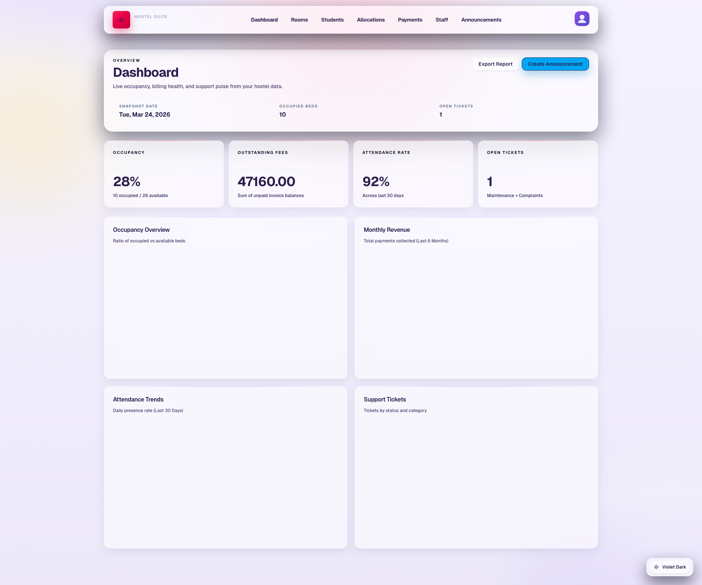

# Hostel Management System (HMS)

A full-stack hostel operations application built with Next.js, Prisma, and PostgreSQL. It ships with role-based admin and student portals, real database-backed authentication, audited write operations, and a production deployment path.



## Screenshots

| Module                | Preview                                       |
| --------------------- | --------------------------------------------- |
| Admin overview        | `public/screenshots/admin-dashboard-current.png` |
| Students              | `public/screenshots/students-dashboard-current.png` |
| Rooms and beds        | `public/screenshots/rooms-dashboard-current.png` |
| Payments              | `public/screenshots/payments-dashboard-current.png` |
| Attendance            | `public/screenshots/attendance-dashboard-current.png` |
| Maintenance           | `public/screenshots/maintenance-dashboard-current.png` |
| Complaints            | `public/screenshots/complaints-dashboard-current.png` |
| Announcements         | `public/screenshots/announcements-dashboard-current.png` |
| Staff                 | `public/screenshots/staff-dashboard-current.png` |
| Allocations           | `public/screenshots/allocations-dashboard-current.png` |
| Account management    | `public/screenshots/manage-accounts-dashboard-current.png` |
| Settings              | `public/screenshots/admin-settings-current.png` |

## Features

- **Authentication and RBAC**: NextAuth credentials login backed by PostgreSQL. Every page and server action re-reads the user and role from the database, rejects deactivated accounts, and enforces `ADMIN` / `STAFF` / `STUDENT` access.
- **Student portal**: Overview, room and bed allocation, invoices and payments, attendance, maintenance/complaint requests, announcements, and profile management.
- **Admin operations**: Students, staff, rooms and beds, allocations, invoices and payments, attendance, maintenance, complaints, announcements, account management, and organization settings.
- **Auditability**: Login attempts, logins, account changes, settings changes, and all administrative writes are recorded in `AuditLog`.
- **Integrity guards**: Duplicate invoice periods, overpayments, room capacity reductions, allocation conflicts, and destructive deletes are validated server-side.
- **Soft deactivation**: Students and staff are deactivated rather than deleted, preserving invoices, attendance, and audit history.
- **Production plumbing**: Environment validation, rate limiting, security headers, health checks, PostgreSQL migrations, and GitHub Actions CI with a database-backed smoke test.
- **UI**: Responsive dashboards, charts, light/violet-dark themes, and accessible shared components.

## Tech Stack

- Next.js 16.4 (App Router, React 19)
- TypeScript
- PostgreSQL 15+
- Prisma 7.10
- NextAuth.js 4
- Tailwind CSS 4
- Zod 4
- Recharts, Radix UI, Lucide, Framer Motion, Sonner

## Requirements

- Node.js `^20.19`, `^22.12`, or `>=24` (CI uses Node 22)
- npm 10+
- PostgreSQL 15+ is optional for local development; `npm run dev` provisions an embedded instance automatically. Production and external-database development require PostgreSQL.

## Local Development

```bash
npm install
npm run dev
```

On first run, `npm run dev`:

- creates `.env` with a local database URL and generated `NEXTAUTH_SECRET` when missing,
- starts embedded PostgreSQL with persistent data in `.local/postgres`,
- generates the Prisma client and applies migrations,
- seeds demo data when the database has no users,
- starts Next.js at `http://localhost:3000`.

Open `http://localhost:3000` and sign in with one of the demo accounts below. Stop the server with `Ctrl+C`; PostgreSQL stops with it.

To reset local demo data, stop the server and delete `.local/postgres`, then run `npm run dev` again.

To use an external PostgreSQL database instead, copy `.env.example` to `.env`, set `DATABASE_URL` and `NEXTAUTH_SECRET`, then run `npm run dev`. Migrations are applied automatically, but demo data is not seeded into external databases. Use `npm run db:create-admin` for a real first administrator, or run the destructive `npm run db:seed` only when you intentionally want demo data.

For schema changes during development, use `npm run db:migrate` and commit the generated migration. Never use `prisma db push` against a production database.

## Environment Variables

| Variable            | Required | Purpose                                                                 |
| ------------------- | -------- | ----------------------------------------------------------------------- |
| `DATABASE_URL`      | Yes      | PostgreSQL connection string.                                           |
| `NEXTAUTH_SECRET`   | Yes      | Signs session JWTs. Use at least 32 random bytes.                       |
| `NEXTAUTH_URL`      | Yes      | Public application origin, for example `https://hms.example.com`.       |
| `APP_URL`           | No       | Base URL used by the smoke test. Defaults to `http://localhost:3000`.   |

Environment variables are validated at server startup by `src/lib/env.ts`. The development command generates missing local values; production deployments must provide all required values explicitly.

## Demo Credentials

Seed data is for development only. These accounts exist after the first `npm run dev` or an explicit `npm run db:seed`.

| Role    | Name               | Email                    | Password     |
| ------- | ------------------ | ------------------------ | ------------ |
| ADMIN   | System Admin       | `admin@hostel.local`     | `admin123`   |
| STAFF   | Mr. Ramesh Sharma  | `warden@hostel.local`    | `staff123`   |
| STAFF   | John Miller        | `tech@hostel.local`      | `staff123`   |
| STUDENT | Suman Kumar        | `suman@student.local`    | `student123` |
| STUDENT | Priya Raj          | `priya@student.local`    | `student123` |
| STUDENT | Amit Singh         | `amit@student.local`     | `student123` |
| STUDENT | Sneha Kapur        | `sneha@student.local`    | `student123` |
| STUDENT | Rohit Verma        | `rohit@student.local`    | `student123` |
| STUDENT | Ananya Das         | `ananya@student.local`   | `student123` |
| STUDENT | Vikram Rathore     | `vikram@student.local`   | `student123` |
| STUDENT | Ishaan Mehta       | `ishaan@student.local`   | `student123` |
| STUDENT | Kavya Iyer         | `kavya@student.local`    | `student123` |
| STUDENT | Rahul Dravid       | `rahul@student.local`    | `student123` |
| STUDENT | Sara Ali           | `sara@student.local`     | `student123` |
| STUDENT | Arjun Reddy        | `arjun@student.local`    | `student123` |
| STUDENT | Inactive Student   | `inactive@student.local` | `student123` |

`inactive@student.local` is intentionally deactivated and cannot sign in; it is used by the smoke test to verify suspended-account handling. Change or remove all demo accounts before exposing a deployment. Never run the seed against production data.

## Scripts

| Script              | Description                                              |
| ------------------- | -------------------------------------------------------- |
| `npm run dev`       | Prepare local PostgreSQL/migrations/seed data and start Next.js. |
| `npm run dev:next`  | Start Next.js without local database setup.              |
| `npm run build`     | Build the production bundle.                             |
| `npm run start`     | Start the standalone production server after a build.    |
| `npm run lint`      | Run ESLint.                                             |
| `npm run typecheck` | Run the TypeScript compiler without emitting.           |
| `npm run db:generate` | Generate the Prisma client into `src/generated/prisma`. |
| `npm run db:migrate`  | Create and apply a development migration.              |
| `npm run db:deploy`   | Apply committed migrations in production/CI.           |
| `npm run db:seed`     | Load demo data.                                        |
| `npm run db:create-admin` | Create/reset the first ADMIN account without seeding. |
| `npm run db:studio`   | Open Prisma Studio.                                    |
| `npm run smoke`       | Run HTTP smoke tests against a running instance.       |

## Production Build and Start

The application runs directly on Node.js against PostgreSQL; no container runtime is required.

```bash
cp .env.example .env
# Set DATABASE_URL, NEXTAUTH_SECRET, and NEXTAUTH_URL in .env

npm ci
npm run db:deploy
npm run build
npm start
curl -fsS http://localhost:3000/api/health
```

Optional demo data is for development only:

```bash
npm run db:seed
```

The seed deletes existing application data before inserting demo records. Never run it against production. Create the first production administrator with `npm run db:create-admin` instead.

See [docs/DEPLOYMENT.md](docs/DEPLOYMENT.md) for admin bootstrap, managed Postgres, TLS, backups, migration procedure, and the production checklist.

## Roles and Route Access

| Area                          | ADMIN | STAFF | STUDENT |
| ----------------------------- | ----- | ----- | ------- |
| `/admin/**`                   | Yes   | Yes   | No      |
| `/admin/settings`             | Yes   | No    | No      |
| `/admin/staff`                | Yes   | No    | No      |
| `/admin/announcements`        | Yes   | No    | No      |
| `/student/**`                 | No    | No    | Yes     |
| `/announcements`              | Yes   | Yes   | Yes     |
| `/api/health`                 | Public | Public | Public |
| `/login`, `/forbidden`        | Public | Public | Public |

Suspended accounts (`User.isActive = false`) cannot sign in and existing sessions are rejected on the next request.

## Security Model

- Passwords are hashed with bcrypt (cost 12 for new and updated passwords).
- Login attempts are limited to 5 failures per identifier and 50 per IP in a 15-minute window.
- Sessions are JWTs with an 8-hour maximum age, refreshed at most once per hour.
- Authorization uses the current database record, not only JWT claims.
- All administrative mutations require an authenticated role appropriate to the resource; staff management, announcements, and settings are `ADMIN`-only. Every administrative write is audited.
- Invoice/payment and bed-allocation writes run in serializable transactions to prevent duplicate invoices and concurrent bed conflicts.
- Security headers (`X-Frame-Options`, `nosniff`, referrer policy, permissions policy) are set in `next.config.ts`. HSTS is enabled in production.
- `/api/health` performs a database query and returns `503` when PostgreSQL is unavailable.
- `npm audit` reports no known vulnerabilities for the committed lockfile; CI fails on high or critical advisories.

Add a Content-Security-Policy at your reverse proxy or CDN after testing your asset and integration requirements. The application does not set a CSP by default because Next.js injects inline hydration scripts.

## CI

`.github/workflows/ci.yml` starts PostgreSQL, installs with `npm ci`, runs the dependency audit, Prisma generate, lint, typecheck, migrations, seed, admin-bootstrap verification, build, and a standalone-server smoke test that verifies:

- the health endpoint and database connectivity,
- unauthenticated `/admin` redirects to `/login`,
- admin login and every admin route,
- staff login and admin-only route isolation,
- student portal access and role isolation,
- deactivated accounts are rejected.

## Project Structure

```text
src/app/(dashboard)/admin   Admin pages and server actions
src/app/(dashboard)/student Student portal and server actions
src/app/api/auth            NextAuth route
src/app/api/health          Readiness/liveness endpoint
src/lib                     Auth, Prisma, audit, rate limit, settings, helpers
src/components              UI, dashboard, auth components
src/generated/prisma        Generated Prisma client (not committed)
prisma/migrations           Committed PostgreSQL migrations
scripts/smoke.mjs           HTTP smoke test
scripts/create-admin.ts     Non-destructive first-admin bootstrap
```

## Operational Notes

- Run `npm run db:deploy` as a release step before starting new application instances.
- Create the first production administrator with `npm run db:create-admin` instead of the destructive demo seed.
- Use a pooled PostgreSQL connection string when deploying to serverless platforms.
- Point `NEXTAUTH_URL` at the exact public origin and terminate TLS at the proxy or platform.
- Audit and login-attempt tables grow over time. Add a retention job appropriate for your compliance requirements.
- Rate limiting is stored in PostgreSQL, so it works across multiple application instances without shared memory.
- The demo seed is intentionally destructive. Use managed database backups before any retention or maintenance task.

## License

No license has been declared for this repository.
